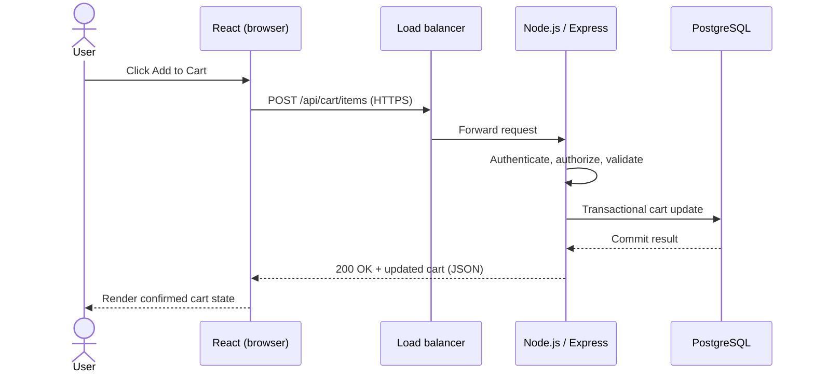

# HTTP Request Lifecycle: React to Node.js

A browser action is only the beginning of a request. A reliable application must carry that request through the network, API, and database, then handle both confirmed results and uncertain failures.

**Scenario:** A customer adds one unit of a product to an existing shopping cart.

**Example stack:** React, HTTPS, a load balancer, Node.js/Express, and PostgreSQL.

## 1. End-to-end architecture



A load balancer is optional in a single-instance deployment; in a scaled deployment, it routes incoming traffic to an available API instance.

### Responsibilities along the path

1. **React:** Collects user intent, sends an HTTP request, and manages loading, success, and error states.
2. **Network / load balancer:** Carries the request over HTTPS and routes it to a backend instance; connections can fail before or after processing.
3. **Express API:** Authenticates the caller, authorizes the action, validates inputs, and applies business rules.
4. **PostgreSQL:** Persists the cart change within the required transaction and constraints.
5. **API response:** Communicates a status and an authoritative representation of the resulting cart.
6. **React:** Updates the UI using the server's result, rather than assuming a database write succeeded.

## 2. Define the API contract

The following endpoint means **add one more unit**, not “set the quantity to one.” That distinction matters when handling retries.

```http
POST /api/cart/items HTTP/1.1
Content-Type: application/json
Idempotency-Key: 550e8400-e29b-41d4-a716-446655440000

{"productId":"p_101","quantityToAdd":1}
```

A successful response for an existing cart might be:

```http
HTTP/1.1 200 OK
Content-Type: application/json

{"cartId":"c_42","items":[{"productId":"p_101","quantity":2}],"itemCount":2}
```

`200 OK` is appropriate for a successful update that returns a representation. `201 Created` is appropriate if this request creates a new resource. Choose a consistent contract and document it.

**Server-side checks:** Confirm the user's identity and cart ownership; require a valid product identifier and positive integer quantity; enforce inventory and purchase limits; determine authoritative product prices from trusted server data. Never accept a browser-supplied price as the amount to charge.

## 3. HTTP methods and idempotency

An operation is **idempotent** if repeating the same operation has the same intended effect on server state as performing it once. Responses need not be identical.

| Method | Common purpose | Idempotent by HTTP semantics? |
| --- | --- | --- |
| `GET` | Retrieve a resource | Yes (also safe/read-only by contract) |
| `POST` | Submit an action or create a resource | No, not by default |
| `PUT` | Replace a resource at a known URI | Yes |
| `PATCH` | Apply a partial modification | Not guaranteed; depends on the patch |
| `DELETE` | Remove a resource | Yes |

For example, repeatedly **setting** quantity to `2` can be idempotent, whereas repeatedly **incrementing** quantity by `1` is not. A `POST` endpoint can still provide idempotent *application behavior* with an idempotency key.

## 4. React request and retry behavior

Generate **one key per intended action** and preserve it when retrying that action. A separate, deliberate Add to Cart action requires a new key.

```js
async function addToCart({ productId, quantityToAdd, idempotencyKey }) {
  const response = await fetch("/api/cart/items", {
    method: "POST",
    headers: {
      "Content-Type": "application/json",
      "Idempotency-Key": idempotencyKey,
    },
    credentials: "include", // For a cookie-based session
    body: JSON.stringify({ productId, quantityToAdd }),
  });

  if (!response.ok) throw new Error(`Cart update failed: ${response.status}`);
  return response.json();
}

// Create this once for a user's action. Retain it for retries.
const action = {
  productId: "p_101",
  quantityToAdd: 1,
  idempotencyKey: crypto.randomUUID(),
};

// On a retry of this same action, call addToCart(action) again.
```

This is an illustrative request helper, not a complete React component. A real UI also manages pending state, cancellation, authentication, and reconciliation after ambiguous failures. Cookies require suitable CSRF defenses; `credentials: "include"` does not provide those defenses by itself.

## 5. Failure scenarios

| Situation | Backend behavior | Frontend behavior |
| --- | --- | --- |
| Invalid request | Return `400` or `422`, with field-level details when appropriate | Show actionable validation feedback |
| No valid login | Return `401` | Prompt for authentication |
| User lacks permission | Return `403` | Do not present the action as successful |
| Conflicting operation | Return `409` with a defined conflict response | Reconcile state or follow documented retry guidance |
| Database unavailable | Return `503` when the dependency is temporarily unavailable | Show a recoverable error; retry when appropriate |
| Database committed, response lost | Reuse durable idempotency results on a retry | Keep the same key; do not assume the write failed |

A network timeout is **ambiguous**: the request may never have arrived, may still be running, or may have committed successfully before the response was lost.

## 6. Safe retries require server-side guarantees

For non-idempotent cart increments, the backend should associate the caller, operation, and idempotency key with a request fingerprint and durable outcome.

A typical database-backed design:

1. Reject reuse of the same key for a **different** request payload.
2. Reserve the key using a uniqueness constraint in the **same database transaction** that changes the cart.
3. Store a replayable result when the transaction commits.
4. On a duplicate request, return the stored result instead of applying the cart increment again.
5. Handle concurrently arriving duplicates and transaction conflicts explicitly.

A unique index on `(userId, productId)` prevents duplicate *item rows* but does **not** by itself prevent an accidental second quantity increment. The idempotency record protects the operation, not just the cart schema.

**Design trade-off:** The API must define how long keys and results are retained. Once a key is forgotten, the backend cannot reliably recognize an old replay without another durable business identifier.

## Key takeaways

- A successful browser interaction requires a confirmed server result, not merely a sent request.
- Backend validation and authorization are mandatory even when React validates inputs.
- HTTP method semantics and application-level idempotency are related but different.
- A lost response is not proof of a failed write.
- Durable, transactionally recorded request identity makes retrying non-idempotent operations safer.

## Further reading

- [MDN: HTTP request methods](https://developer.mozilla.org/en-US/docs/Web/HTTP/Reference/Methods)
- [MDN: Idempotency-Key header](https://developer.mozilla.org/en-US/docs/Web/HTTP/Reference/Headers/Idempotency-Key)
