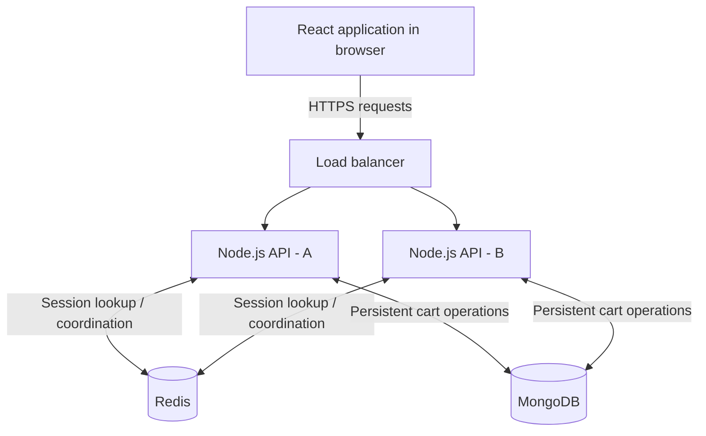

# Client–Server Architecture with React and Node.js

Client–server architecture separates the user-facing application from the services that enforce rules and persist data. This separation is a **trust boundary**, not merely a way to organize source code.

**Scenario:** A logged-in customer adds a product to a cart while multiple Node.js instances serve requests.

**Example stack:** React, Node.js/Express, a load balancer, Redis for shared sessions and short-lived coordination, and MongoDB for durable cart data.

## 1. Architecture and responsibilities



| Browser / React | API / Node.js |
| --- | --- |
| Render products, cart totals, and notifications | Authenticate the caller and authorize cart access |
| Capture clicks and collect form data | Validate input and enforce business rules |
| Show pending, success, and error states | Fetch trusted product data and determine pricing |
| Send requests and reconcile responses | Coordinate concurrent operations and persist changes |

**Trust boundary:** A user can edit browser state and HTTP requests. If the browser submits `{"productId":"p_101","price":1}`, the API must ignore the untrusted price and use authoritative product data. Hiding controls or validating in React is useful for UX, but it is not authorization.

## 2. Authentication across multiple API instances

A login request may reach API A while the next request reaches API B. If A keeps the login session only in local memory, B cannot independently recognize it.

A common session-based design is:

1. API A authenticates the user and creates a session in shared Redis storage.
2. The browser receives a session ID in a cookie configured with `HttpOnly`, `Secure`, and an appropriate `SameSite` policy.
3. On a later request, either API instance uses that session ID to look up the shared session.
4. The API verifies the user's authorization before accessing the cart.

This keeps individual **API instances stateless with respect to local session memory**; the overall application still has state in Redis and MongoDB. Cookie-based authentication also requires appropriate CSRF protection. A signed token-based architecture is another option, with different revocation and operational trade-offs.

## 3. UI consistency: optimistic updates

React may show a cart count change before the server confirms it. This is an **optimistic update**.

- **Confirmed success:** Replace the optimistic value with the authoritative cart returned by the API.
- **Definitive rejection:** Roll back the optimistic change and show a useful error.
- **Timeout / connection loss:** The outcome is unknown. Retry or fetch the authoritative cart before deciding whether to roll back.

Disabling an Add to Cart button while pending can improve UX, but it is not an idempotency guarantee. If the user intentionally performs **two separate adds**, each action should have its own idempotency key; retries of one action reuse that action's key.

## 4. Concurrent requests and Redis atomicity

Two load-balanced servers may receive the **same logical request** at nearly the same time. A check-then-set implementation is unsafe:

```js
// Unsafe: another server may run between these two commands.
if (!(await redis.exists(key))) {
  await redis.set(key, "processing");
}
```

Use a **single atomic conditional command** for a short-lived processing reservation:

```redis
SET idempotency:user_7:abc123 processing NX EX 300
```

- `SET`: assign the key's value.
- `NX`: succeed only if the key does not yet exist.
- `EX 300`: expire the reservation after 300 seconds.

On one authoritative Redis primary, competing commands are executed in an order; the first one executed for an absent key succeeds, and later `SET ... NX` commands fail while that key exists. **The winner is not predetermined**—it depends on arrival and scheduling.

| Server A | Server B | Outcome |
| --- | --- | --- |
| `SET ... NX` returns `OK` | Returns nil / no reservation | A can proceed; B must not perform the same write |
| Returns nil / no reservation | `SET ... NX` returns `OK` | B can proceed; A must not perform the same write |

When the reservation exists, the API can return a documented in-progress/conflict response (for example, `409` with retry guidance) or wait briefly for a completed result. A production implementation also needs timeouts, ownership-safe cleanup, and handling for crashed workers. **Redis is coordination, not the durable source of truth.**

## 5. Durable idempotency in MongoDB

Consider this failure sequence:

```text
API A reserves key in Redis
    → MongoDB cart update commits
    → API A crashes before recording completion in Redis
    → Redis reservation expires
    → Request is retried on API B
```

If Redis is the only protection, B may apply the cart increment again. To protect the **database effect**, persist the operation identity in MongoDB along with the cart mutation.

### Transactional approach

1. Identify the authenticated user and validate the request payload.
2. Use a unique index for the idempotency record, such as `(userId, idempotencyKey)`; store a request fingerprint.
3. In **one MongoDB transaction**, record the operation, apply the cart change, and persist the replayable outcome.
4. If the same key and payload are retried, return the committed outcome without applying another increment.
5. If the key is reused with different payload data, reject it (for example, with `409 Conflict`).
6. If a concurrent transaction collides, resolve the conflict by checking the committed record or returning a documented in-progress response—not by blindly repeating the write.

MongoDB supports multi-document transactions on replica sets and sharded clusters. Transaction guarantees and durability depend on appropriate configuration, including write concern. A unique cart-item index such as `(userId, productId)` prevents duplicate item documents, but alone does not prevent a duplicate **quantity increment**. On sharded collections, unique-index design must also respect shard-key restrictions.

**Result:** The application can enforce one committed cart effect per retained idempotency key even if an API instance crashes. This is an *effectively-once outcome under a defined key and retention policy*, not a claim that an HTTP request or handler executes literally once.

## 6. End-to-end request handling

```text
React: POST /api/cart/items + Idempotency-Key
    → Load balancer chooses API A or B
    → API reads session from shared Redis
    → API authenticates, authorizes, and validates
    → Optional Redis reservation reduces concurrent duplicate work
    → MongoDB transaction records the operation and updates the cart
    → API returns 200 OK + authoritative cart JSON
    → React reconciles the UI with the response
```

**Failure-handling contract:** An in-flight duplicate should not modify the cart; an already-completed duplicate should return its stored result; a lost response should lead the client to retry the **same** key. If the database is unavailable, report an appropriate error rather than claiming success.

## Key takeaways

- The React–Node.js boundary is a security and data-integrity boundary.
- Shared sessions allow requests to move between API instances without relying on local memory.
- Optimistic UI is a presentation strategy; it does not establish server-side correctness.
- `SET ... NX` atomically reserves a Redis key and prevents simultaneous reservation while that key exists.
- Redis expiry and worker crashes require durable, database-level idempotency for sensitive writes.
- A key identifies **one intended operation**; a separate intentional action needs a separate key.

## Further reading

- [Redis: SET command](https://redis.io/docs/latest/commands/set/)
- [MongoDB: Transactions](https://www.mongodb.com/docs/manual/core/transactions/)
- [MongoDB: Unique indexes](https://www.mongodb.com/docs/manual/core/index-unique/)
